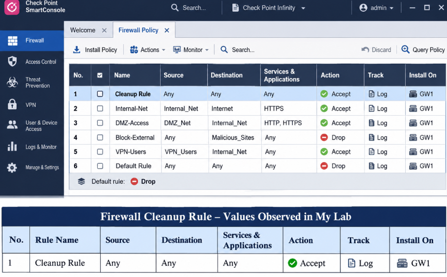
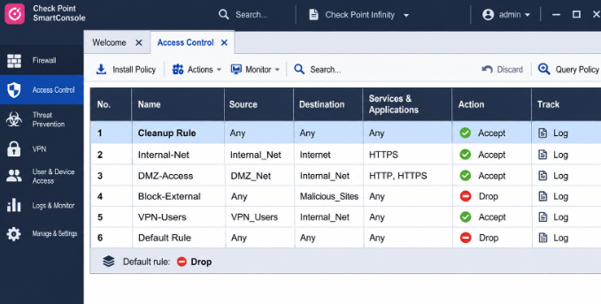
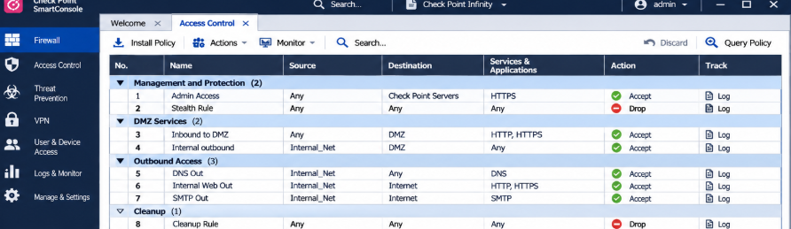
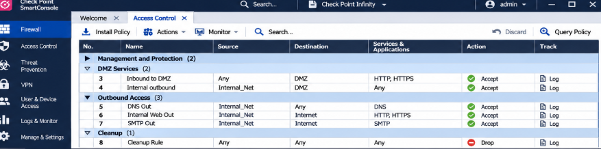
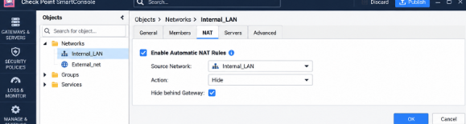
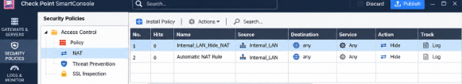
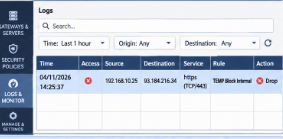
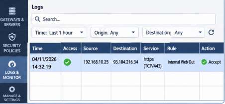

# CCSA104 – Managing Security Policies (Practical Assignment solution)

Practical assignment for the **Check Point Certified Security Administrator (CCSA)** course, module **CCSA104 – Managing Security Policies** (Cohort 11, 2026).

**Student name:** Haruna Hamidu
**Student id:** c11_2026_CCSA_17060

This repository documents the lab work done in **Check Point SmartConsole**:by exploring the default policy, building an Access Control rulebase, organising it with section titles, configuring Hide NAT, and testing how rule order affects traffic. It also contains the written theory answers (Part B).

---

## Contents

| Part | Topic |
| --- | --- |
| Part A | Hands-on lab tasks (SmartConsole) |
| Part B | Theory answers (B1 multiple choice, B2 short answers, B3 scenarios) |

---

## Part A – Practical Lab

### Task 1 – Explore the default policy
- Logged in to SmartConsole as an administrator and opened the **Security Policies** view.
- Identified the existing **Cleanup rule** at the bottom of the Access Control rulebase and recorded it.
- Right-clicked a column heading to enable **Hits**, **Track** and **Install On**, then hid and re-enabled a column to confirm columns can be customised.
- Opened **Global Properties** and reviewed the available categories.

### Task 2 – Build the Access Control rulebase
Network and host objects were created first:

| Object name | Type | Value | Purpose |
| --- | --- | --- | --- |
| `Internal_LAN` | Network | 10.1.1.0/24 | Staff network |
| `DMZ_Net` | Network | 172.16.10.0/24 | DMZ network |
| `Admin_PC` | Host | 10.1.1.101 | Administrator workstation |
| `Web_Server` | Host | 172.16.10.20 | Public web server |
| `Mail_Server` | Host | 172.16.10.25 | Mail server |
| `External_DNS` | Host | 192.9.100.10 | External DNS server |

Rules were inserted **above** the existing Cleanup rule (no second Cleanup rule was created). The existing Cleanup rule's **Track** setting was changed to **Log** and kept at the bottom.

### Task 4 – Organise the rulebase with sections
Rules were grouped using **New Section Title**:

| Section | Rules |
| --- | --- |
| Management and Protection | 1. Admin Access, 2. Stealth Rule |
| DMZ Services | 3. Inbound to DMZ, 4. Internal outbound |
| Outbound Access | 5. DNS Out, 6. Internal Web Out, 7. SMTP Out |
| Cleanup | 8. Cleanup Rule |

One section title was also edited and then restored to its required name.

| Sections expanded | One section collapsed |
| --- | --- |
|  |  |

### Task 6 – Configure Hide NAT
- Opened the `Internal_LAN` network object → **NAT** tab.
- Enabled **automatic address translation**, method **Hide**, **Hide behind Gateway**.
- Published the change and verified the automatically generated rule in the NAT rulebase.

| Internal_LAN NAT settings | NAT rulebase |
| --- | --- |
|  |  |

### Task 7 – Rule order experiment
A temporary rule (**TEMP Block Internal**) was placed above and then below **Internal Web Out**, and the resulting traffic logs were compared.

| Temp rule **above** Internal Web Out → traffic dropped | Temp rule **below** Internal Web Out → traffic accepted |
| --- | --- |
|  |  |

> **Note:** The *Installation History* screenshot could not be captured because of a power outage at the training centre.

**Takeaway:** Check Point evaluates rules from top to bottom and applies the first match. Specific rules must therefore sit above general ones, otherwise broad rules override the intended restrictions.

---

## Part B – Theory ( answers)

**B1 – Answers:** B, A, C, D, C

**B2 – i just only make an explantion on the  Key concepts**
- **Explicit vs implied rules**, and the **implicit cleanup action** (unmatched traffic is dropped; an explicit Cleanup rule makes the drop and logging visible).
- **Why rule order matters** – first-match evaluation, top to bottom.
- **Save vs Publish vs Install** – save keeps changes in the session, publish makes them official on the Management Server, install pushes them to the gateway.
- **Global Properties vs Policy Packages.**
- **Security Zones** – Internal, External, DMZ, Undefined – and interface-assignment rules.

**B3 – Scenarios answers**
1. **Any-to-Any Accept above the Stealth rule** – defeats the positive control model and exposes the gateway itself. Fix: remove or tightly scope it; only a Management rule (restricted to authorised admin sources) belongs above the Stealth rule.
2. **Hide NAT configured but staff cannot reach the web** – benefits of NAT: address conservation and internal address hiding. Checks: verify the NAT rulebase/translation settings, and verify gateway routing, interface status and DNS resolution.

- Check Point SmartConsole (Security Management Server + Security Gateway `GW1`)

